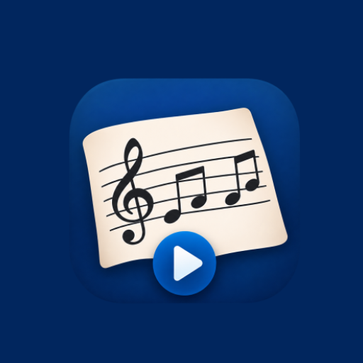

# Pizzinotta

<p align="center">
  
</p>

<p align="center">
  <strong>The simple sheet-music reader for live playing.</strong>
</p>

---

## Why this exists

I could never find a **simple** app that did what I actually needed: import my PDF sheet music and group it into
sets I could play through live — without a fiddle of metadata, folders, or composer fields. Every option out there
was either bloated, tied to a cloud service, or missing the gesture-driven page turning that makes reading on a music
stand feel natural.

So I built **Pizzinotta**. It's the app I wanted: bring in your PDFs, put them into playlists (setlists), and turn
pages with taps — nothing more.

This project was created with the help of **AI agents**, building feature-by-feature and reviewing each step along the
way. It's open-source, free, and ad-free — meant to keep being simple.

---

## What it does

- **Import** PDFs from your device picker, or via Share / "Open with" from any other app. Files are copied into the
  app (never touched in place), and exact duplicates are skipped automatically.
- **Library** — a flat, searchable, sortable list of your songs. Rename titles, multi-select, add to playlists, delete.
- **Playlists** — ordered setlists for a gig: drag to reorder, swipe to remove, rename or delete. A song missing from
  disk drops out silently so your setlist never breaks.
- **Reader** — one page at a time, fit-to-screen, immersive, with the screen staying awake. Tap the edges to turn
  pages or jump songs; tap the center to show or hide the bar. No buttons to hunt for mid-song.

> This is **Phase 1 (MVP)**. Longer-term ideas — annotations, cloud sync, cross-device backup — are sketched in
> [`docs/PRD.md`](docs/PRD.md) as forward context but are not part of this build.

See the full behaviour and acceptance criteria in [`docs/PRD.md`](docs/PRD.md), and the design decisions in
[`docs/ARCHITECTURE.md`](docs/ARCHITECTURE.md).

---

## Requirements

- **Android SDK** with AGP 9.x (pinned in `gradle/libs.versions.toml`)
- **JDK 17+**
- **Kotlin 2.4**, Jetpack Compose, Room (KSP), and [pdfiumandroid](https://github.com) (Apache-2.0 PDF engine)
- Min SDK **26** (Android 8.0) · target SDK **37**

No Firebase account or configuration is required — the app builds and runs fully offline for Phases 1–2.

---

## Getting started

1. Clone the repo:

   ```bash
   git clone https://github.com/dbarbosapn/pizzinotta.git
   cd pizzinotta
   ```

2. Open the project in **Android Studio** (latest stable) and let Gradle sync.

3. Run on a connected device or emulator — select the `app` configuration and press **Run**.

### Build from the command line

Gradle starts a daemon JVM that inherits the shell's stdout pipe and keeps it open after `gradlew` returns, so the
terminal can appear to hang. Always pass `--no-daemon`:

```bash
# Assemble a debug APK
./gradlew assembleDebug --no-daemon

# Run unit tests (pure JVM/JUnit4 — no emulator needed)
./gradlew testDebugUnitTest --no-daemon
```

> On Windows, use `gradlew.bat` if the shell script isn't executable.

---

## Project structure

```
app/src/main/java/com/github/dbarbosapn/pizzinotta/
├── MainActivity.kt                 # Compose host + navigation entry point
├── PizzinottaApplication.kt        # App singleton
├── data/
│   ├── domain/                     # Pure-Kotlin records (Song, Playlist, Queue) — no Android deps
│   ├── import/                     # Import pipeline: hash → pdfium validate → copy → persist
│   ├── reader/                     # PDF document + queue/boundary logic
│   ├── repository/                 # Room-backed repositories
│   ├── room/                       # Entities, DAOs, projections, AppDatabase
│   └── storage/                    # On-disk file management (<uuid>.pdf)
└── ui/
    ├── theme/                      # Material 3 theme (follows system light/dark)
    ├── nav/                        # Lightweight Compose navigation (sealed Screen type)
    ├── library/                    # Library screen + tests
    ├── playlists/                  # Playlists list/detail screens + tests
    ├── import/                     # Import UI + tests
    └── reader/                     # Custom View/SurfaceView reader, page cache/layout, tap zones + tests
```

### Architecture

**MVVM + Repository**, with state exposed via `StateFlow`/`SharedFlow` and collected through
`collectAsStateWithLifecycle`. The playlist ordering, queue construction, and tap-boundary logic live in a
**pure-Kotlin domain layer** (no Android dependencies) so they stay unit-testable.

| Concern        | Approach                                                                                     |
|----------------|----------------------------------------------------------------------------------------------|
| UI (non-reader)| Jetpack Compose + Material 3, follows system light/dark theme                                |
| Reader         | Custom `View`/`SurfaceView`; layout and rendering kept separate; gestures handled directly     |
| Persistence    | Room over SQLite; entities use UUIDs + timestamps for stable identity and future sync          |
| On-disk files  | PDFs copied as `<uuid>.pdf`; `contentHash` (SHA-256) is the pre-write dedup key                |
| PDF engine     | [pdfiumandroid](https://github.com) (Apache-2.0), behind a small interface                     |

See [`docs/ARCHITECTURE.md`](docs/ARCHITECTURE.md) for the full decisions log.

---

## Testing

Unit tests live in `app/src/test` (pure JVM/JUnit4) and cover the domain records, repositories (via fakes), import
pipeline, reader queue/boundary logic, navigation routes, and library UI state. They need **no emulator**:

```bash
./gradlew testDebugUnitTest --no-daemon
```

Instrumented tests for reader tap/gesture behaviour are planned for Phase 4 (`app/src/androidTest`).

---

## Roadmap (forward context)

- **Phase 2** — Page annotations (pen, highlighter, notes), and pull-only Google Drive sync from a single folder.
- **Phase 3** — Optional account with Firebase: cross-device sync of files, playlists, titles, and last-read pages.
- **Phase 4** — Automated domain/queue tests plus instrumented reader gesture tests and a performance check on an
  API 26 / 2 GB profile.

Full detail in [`docs/PRD.md`](docs/PRD.md) §4–§8, including the explicitly rejected "non-goals".

---

## License

Distributed under the **Apache-2.0** license. The PDF engine ([pdfiumandroid](https://github.com)) is Apache-2.0;
there are no AGPL/GPL dependencies (MuPDF excluded). See [`docs/PRD.md`](docs/PRD.md) §2 for the licensing constraints.
